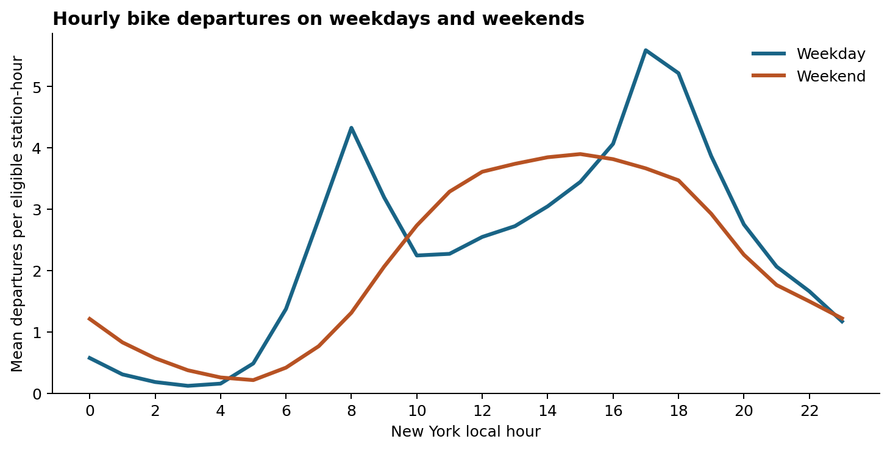
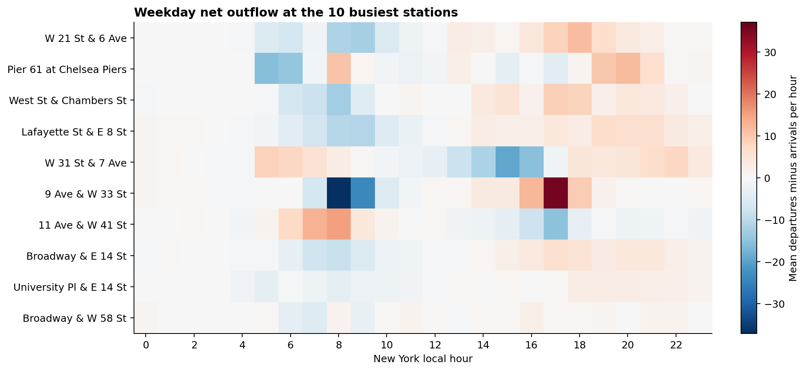
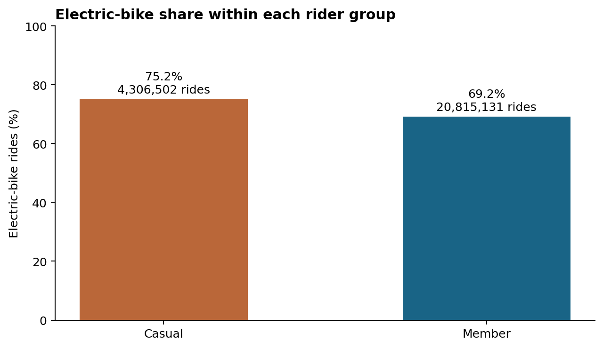
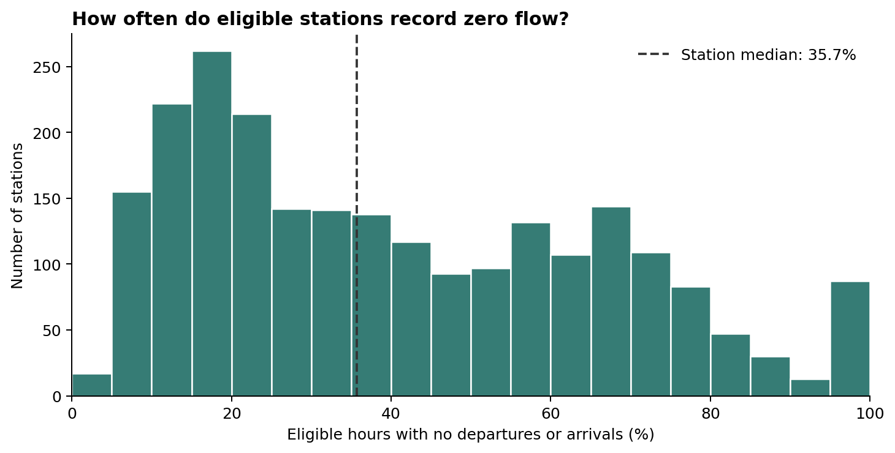

# Exploratory analysis for the intermediate check-in

All four figures use January 1 through July 31, 2025 in New York local time. A, B and D include only station-hours eligible at the start of the hour under the 24-hour activity rule. C includes rides by their start time. Each figure has a matching CSV in the eda directory. To reproduce them, install matplotlib and numpy alongside DuckDB and run `python scripts/eda_2025.py` from the project root.

## A. Weekday and weekend departures

At 8 am the mean was 4.32 departures per eligible station-hour on weekdays and 1.31 on weekends. The weekday peak occurred at 5 pm (5.59), while the weekend peak occurred at 3 pm (3.90). These differences motivate grouping the historical baseline by station, hour and weekday/weekend. Weekdays include holidays that fell on Monday through Friday.

## B. Net flow at busy stations

The ranking uses combined departures and arrivals across all eligible hours in the training period. Each cell averages departures minus arrivals over eligible weekday hours at that station and clock hour. At 8 am, Pier 61 at Chelsea Piers averaged 10.47 more departures than arrivals, while W 21 St & 6 Ave averaged 11.34 more arrivals than departures. At 5 pm, both signs reversed. This illustrates why station identity matters in forecasting. Inferring an actual shortage would also require inventory data.

## C. Electric-bike use by rider type

Electric bikes accounted for 75.18% of 4,306,502 casual rides and 69.22% of 20,815,131 member rides, a difference of 5.95 percentage points using unrounded shares. These are ride-level descriptive proportions. A subsequent stratified test can examine whether the contrast persists within comparable stations and times.

## D. Zero-flow hours across stations

Of 11,077,529 eligible station-hours, 4,212,466 had no recorded departures or arrivals (38.03%). Each of the 2,350 stations contributes once to the histogram. The median station had zero flow in 35.67% of its eligible hours, and the middle half ranged from 18.59% to 61.37%. Removing quiet hours would raise the historical mean and change the population used to score forecasts. A recent event establishes eligibility, so an outage inside the lookback window can still appear as a zero.
