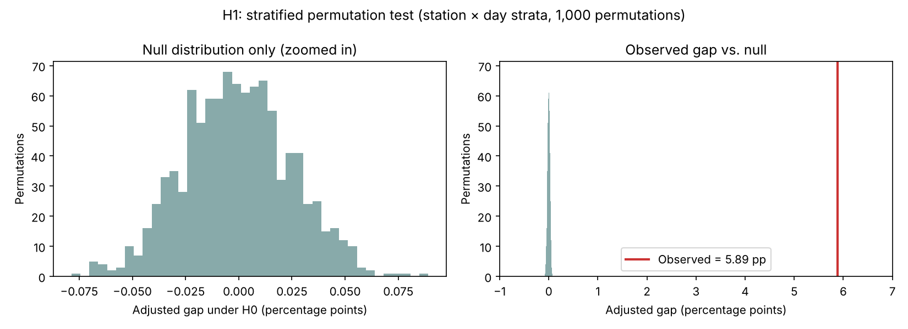
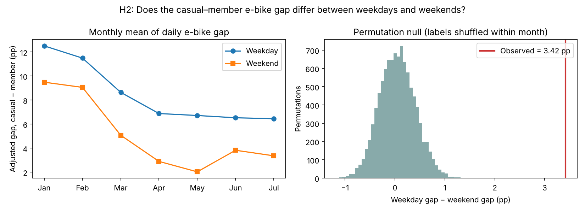

# Hypothesis testing for the intermediate check-in

Both tests use rides that started from January 1 through July 31, 2025 in New York local time, the same window as the [EDA](eda.md). Later months are kept for forecast validation and testing. The full analysis is in [the notebook](../notebooks/hypothesis_testing.ipynb). To reproduce it after cleaning, run `python scripts/export_daily_counts.py` from the project root and then run the notebook.

## H1. Electric-bike use by rider type

EDA figure C shows that 75.18% of casual rides and 69.22% of member rides used an electric bike, a gap of 5.95 percentage points. Casual riders tend to ride on weekends and near tourist areas, so the gap might reflect where and when they ride rather than the riders themselves.

- **H0:** within the same station and day, members and casual riders use electric bikes at the same rate.
- **H1:** the rates differ (two-sided).
- **Statistic:** the casual − member difference in electric-bike share, averaged across station × day strata with Mantel–Haenszel weights. A stratum enters only if both rider types started a ride there that day. These strata hold 99.9% of casual and 98.0% of member rides.
- **Test:** a stratified permutation test with 1,000 permutations. Labels are reassigned only within each stratum, holding its ride and electric-bike counts fixed.
- **Interval:** a 95% bootstrap interval that resamples whole days, because rides on the same day are not independent.

| Measure | Result |
| --- | ---: |
| Unadjusted gap | 5.95 pp |
| Station × day adjusted gap | 5.89 pp |
| 95% CI (day bootstrap) | 5.44 to 6.34 pp |
| Permutation p-value | < 0.001 |
| Days with an adjusted gap of zero or less | 1 of 212 |

Comparing riders at the same station on the same day leaves the gap almost unchanged. Location and date do not explain why casual riders use electric bikes more often. The day-level bootstrap is about nine times wider than the permutation distribution, which shows that dependence among rides matters. The interval still lies far from zero.

The trip records cannot identify the cause. In 2025 members paid a lower per-minute e-bike fee than non-members, so the fee difference alone does not explain the gap.

## H2. Weekday and weekend gap

On weekdays many members commute while casual riders mostly ride for leisure. On weekends both groups mostly ride for leisure. If trip purpose drives part of the gap, it should shrink on weekends.

- **Daily gap:** the station-adjusted casual − member gap for each day, computed as in H1.
- **H0:** the mean daily gap is the same on weekdays and weekends.
- **H1:** the means differ (two-sided).
- **Test:** a permutation test with 10,000 permutations. Weekday and weekend labels are shuffled only within the same month to hold seasonal changes fixed.
- **Interval:** a 95% bootstrap interval that resamples days within each month × day-type cell.

| Measure | Result |
| --- | ---: |
| Weekday mean gap (152 days) | 8.45 pp |
| Weekend mean gap (60 days) | 5.03 pp |
| Difference | 3.42 pp |
| 95% CI | 2.82 to 4.07 pp |
| Permutation p-value | < 0.001 |
| Difference without the six federal holidays | 3.49 pp (CI 2.92 to 4.08) |

The gap is about 40% smaller on weekends, and the weekend gap is lower in every month. It does not disappear. This pattern fits trip purpose explaining part of the gap, with a remaining difference between the two rider groups. Weekdays and weekends also differ in station use and bike availability, so the result is an association, not a causal estimate.

H1 pools rides, so busy days carry more weight. H2 weights every day equally. Busier summer days have smaller gaps, so the pooled H1 estimate is lower than the weekday and weekend averages suggest.

## Limitations

- The trip records do not include station inventory, so an electric bike may have been unavailable when a rider arrived.
- The records do not include fares. Members pay a lower per-minute e-bike fee.
- Without rider IDs, repeat riders make rides dependent. The day-level bootstrap accounts for dependence within a day but not across days.
- The window covers January through July. A full-year check can follow once the forecasting test period is no longer needed.

## Future work

The adjusted gap falls from about 12 pp in January to about 6 pp in July. Neither hypothesis covered this pattern, so it needs its own test before drawing conclusions.
