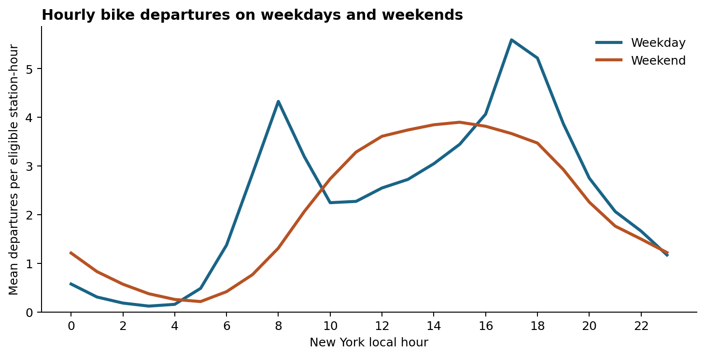
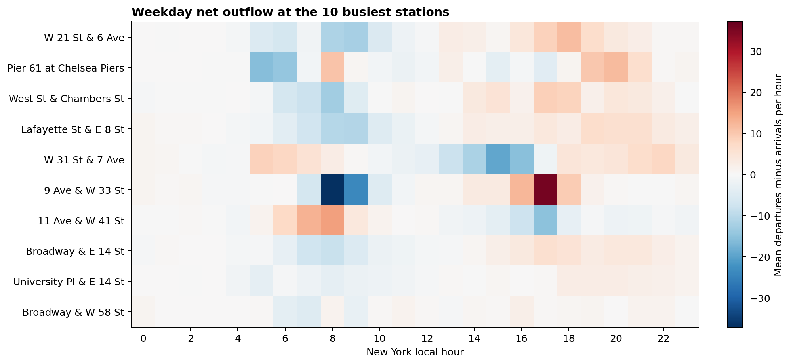
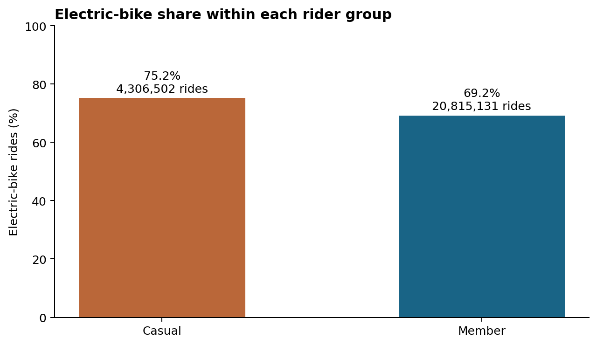
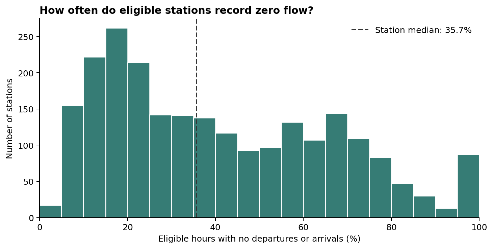

# Intermediate Check-In Overview

## 1. Data Preparation

**Our primary objective is to forecast hourly departures and arrivals at individual Citi Bike stations.** Their difference gives predicted net outflow, which can help identify stations facing potential inventory pressure. Our secondary objective is to examine differences between member and casual rides.

We downloaded the **12 monthly NYC Citi Bike releases for 2025**, containing **45,771,102 unique rides**. We used Python and DuckDB to validate, clean and aggregate the data, and saved the outputs as Parquet files.

**The main cleaning issues and decisions were as follows.**

- **Missing station information.** There were 20,271 rides without a start station ID and 130,332 without an end station ID. We handled the endpoints independently. A ride with a valid start station still contributes a departure even if its end station is missing.
- **Station identifiers and coordinates.** We stored station IDs as text, trimmed whitespace and converted empty strings to missing values. Coordinates outside valid latitude or longitude ranges become missing. The population follows the NYC releases, including any cross-system or operational station IDs present.
- **Time alignment and daylight saving time.** Departures use the start timestamp and station; arrivals use the end timestamp and station. We use UTC for hourly alignment and New York local time for calendar features. We flagged **4,829 rides with ambiguous or invalid local clock times** and excluded ambiguous clock hours from forecasting targets.
- **Questionable ride durations.** We retained source rides and added an eligibility flag for duration-based analysis. A usable duration must be known, positive and no longer than 24 hours. The threshold is an analytical choice for typical rides. Valid endpoint events remain available for flow counts.
- **Zero-flow hours and station activity.** An absent record could reflect a quiet hour, a closure or missing coverage. We considered a station eligible if it had a recorded departure or arrival in the **previous 24 hours**. Eligible hours with no events receive zero departures and arrivals.

**The activity rule is an assumption that affects our forecast population.** It uses information available at prediction time, but may include temporary outages and exclude operating low-volume stations. Our annual table contains **18,981,354 eligible station-hours**, including **7,022,125 inferred zero-flow hours**.

We verified ride-count preservation, uniqueness of station–hour rows, consistency of inferred zeros and reconciliation of departure and arrival totals.

Source details are in [the cleaning walkthrough](data-cleaning.md) and [cleaning audit](../data/clean/audit.json).

## 2. Exploratory Data Analysis

Our four figures use **January–July 2025**. Station-level figures use the eligible-hour definition above.

**Figure A — Hourly departures on weekdays and weekends**

At 8 am, mean departures per eligible station-hour were **4.32 on weekdays** and **1.31 on weekends**. The weekday peak occurred at **5 pm**, while the weekend peak occurred at **3 pm**.

This supports including **hour of day and day type** in forecasting. It also motivates testing a weekday/weekend refinement of our current station-and-hour historical baseline.

**Figure B — Net outflow at the ten busiest stations**

We selected the ten busiest stations by combined departures and arrivals in the EDA period, then plotted average weekday net outflow by hour.

At 8 am, **Pier 61 at Chelsea Piers** averaged **10.47 more departures than arrivals**, while **W 21 St & 6 Ave** averaged **11.34 more arrivals than departures**. At 5 pm, both directions reversed.

This demonstrates why **station-specific predictions** matter. Different stations can experience opposite flow patterns during the same hour. Identifying actual shortages would require inventory and capacity data.

**Figure C — Electric-bike share by rider type**

Electric bikes accounted for **75.18% of casual rides** and **69.22% of member rides**, a difference of **5.95 percentage points** using unrounded values.

This motivates our first hypothesis test, which examines whether the difference persists within the **same station and day**.

**Figure D — Distribution of zero-flow hours across stations**

Across January–July, **38.03% of eligible station-hours** had no recorded departures or arrivals. The median station had zero flow in **35.67%** of its eligible hours.

Removing quiet hours would inflate historical mean demand and change the evaluation population. The distribution also highlights differences in activity across stations.

Definitions and underlying summaries are documented in [the EDA notes](eda.md).

## 3. Modeling

**We have already implemented and evaluated the baseline and multiple candidate models.** For the two-model discussion, we emphasize **Poisson regression and random forest**, with standard gradient boosting as an additional comparison.

**Prediction target and validation strategy**

We predict departures and arrivals separately for each eligible station-hour.

| Stage | Period |
| --- | --- |
| Training | April–July 2025 |
| Validation and model selection | August 2025 |
| Final refitting | April–August 2025 |
| Test evaluation | September 2025 |

The cleaned data cover the full year; the table describes the periods used for the existing model results.

The demand-modeling run covers **2,342 stations**, with approximately **6.40 million training rows**, **1.60 million validation rows** and **1.55 million test rows**.

We simulate **rolling one-hour-ahead prediction**. Earlier observed September flows can become inputs for later September forecasts. Features include station identity, calendar variables, flows from 1, 24 and 168 hours earlier, and historical 24-hour averages. Weather and holiday features are still pending.

**Baseline and model choices**

| Model | Rationale and trade-offs |
| --- | --- |
| **Historical average baseline** | Predicts the training-period mean for each station and hour. Missing combinations fall back to the station mean, then the overall mean. It is transparent but responds weakly to recent changes. |
| **Poisson regression** | Matches the nonnegative count target and provides a relatively interpretable model. Its structured relationship between predictors and expected counts may miss complex interactions. |
| **Random forest** | Captures nonlinear relationships and interactions among stations, time and recent flows. It offers flexibility, with higher computational cost and less direct interpretability. |
| **Standard gradient boosting** | Provides an additional nonlinear comparison by sequentially fitting trees. We use scikit-learn's GradientBoostingRegressor. |

Preprocessing is fitted on training data. Parameters and the preferred model are selected using **August MAE**. All methods are evaluated on the same target rows. Learned models use the same candidate features with model-appropriate preprocessing.

**Metrics and existing performance**

**MAE** expresses average absolute error in rides per station-hour. **RMSE** gives greater weight to large errors. We also evaluate weekday peak hours separately.

These are **September test results**.

| Model | Departure MAE | Departure RMSE | Arrival MAE | Arrival RMSE |
| --- | ---: | ---: | ---: | ---: |
| Historical average | 1.6803 | 3.4591 | 1.7008 | 3.5132 |
| Poisson regression | 1.5830 | 2.9906 | 1.6038 | 3.0474 |
| **Random forest** | **1.4285** | **2.6355** | **1.4538** | **2.6764** |
| Gradient boosting | 1.5081 | 2.7670 | 1.5286 | 2.8081 |

**Random forest was selected using August performance for both targets.** September departure MAE improved by **14.99%** and arrival MAE by **14.53%** relative to the baseline.

For net outflow, the selected model pair reduced MAE from **1.6597 to 1.6046**, an improvement of **3.32%**. Departure and arrival errors can cancel or reinforce when subtracted.

**Secondary task — Rider-type classification**

We compared logistic regression, random forest and gradient boosting. Gradient boosting was selected by August ROC-AUC and achieved a **September ROC-AUC of 0.708**, compared with **0.693** for logistic regression.

The test sample is **81.17% member rides**, and casual recall is approximately **12%** at the current threshold. This limits the model's ability to identify casual rides.

Because predictors include duration and endpoints, this is **retrospective ride-pattern analysis**. High member scores on casual rides represent similarity to observed member rides. Assessing membership purchases would require conversion outcomes.

Results and notebook links are provided in [the modeling notes](modeling.md).

## 4. Hypothesis Testing

We completed two analyses using **January–July 2025** rides. Both report effect sizes, permutation tests and bootstrap confidence intervals.

**Hypothesis 1 — Does electric-bike usage differ between rider types within comparable station-days?**

- **Null hypothesis.** Within the same start station and day, members and casual riders have equal electric-bike usage rates.
- **Alternative hypothesis.** Their rates differ.
- **Statistic.** The casual-minus-member difference averaged across station–day strata containing both rider types, using Mantel–Haenszel weights.
- **Method.** A stratified permutation test with **1,000 permutations**, holding rider-group sizes and electric-bike totals fixed within each stratum.
- **Uncertainty.** A **95% bootstrap interval resampling whole days**, allowing rides within a day to vary together.

The adjusted difference was **5.89 percentage points**, with a **95% confidence interval of 5.44–6.34 percentage points**. The permutation p-value was **below 0.001**. With 1,000 permutations, the smallest attainable corrected p-value is approximately 0.000999.

The gap remains substantial after station–day adjustment. Time-of-day differences, availability and other unobserved factors may still contribute.

**Hypothesis 2 — Does the adjusted rider-type gap differ between weekdays and weekends?**

- **Null hypothesis.** The mean daily adjusted gap is equal on weekdays and weekends.
- **Alternative hypothesis.** The means differ.
- **Statistic.** The weekday mean daily gap minus the weekend mean daily gap.
- **Method.** A permutation test with **10,000 permutations**, shuffling weekday/weekend labels within each month.
- **Uncertainty.** A **95% bootstrap interval resampling days within month-by-day-type groups**.

The mean adjusted gap was **8.45 percentage points on weekdays** and **5.03 on weekends**. The difference was **3.42 percentage points**, with a **95% confidence interval of 2.82–4.07 percentage points** and a **p-value below 0.001**.

Excluding six federal holidays produced a difference of **3.49 percentage points**, with a **95% confidence interval of 2.92–4.08**.

**Interpretation and assumptions**

The observed rider-type gap is smaller on weekends. Differences in trip purpose are a possible explanation, but trip purpose is unobserved.

Permutation procedures depend on exchangeability within their groups. Repeated riders and dependence across dates may challenge this assumption. Day-level bootstrapping addresses dependence within a day; dependence across days remains a limitation.

**H1 gives more influence to high-volume strata; H2 weights days equally.** The estimates answer different questions.

Findings apply to recorded rides in January–July. Historical bike availability, persistent rider identifiers and conversion outcomes would be needed for broader behavioral or causal questions.

Methods, notebook links and saved findings are in [the hypothesis-testing notes](hypothesis-testing.md).

---

This overview summarizes existing project code, documentation and saved results. Creating this document did not rerun model fitting or statistical tests.
