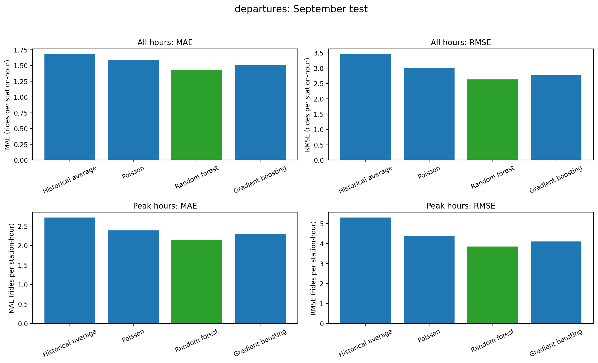
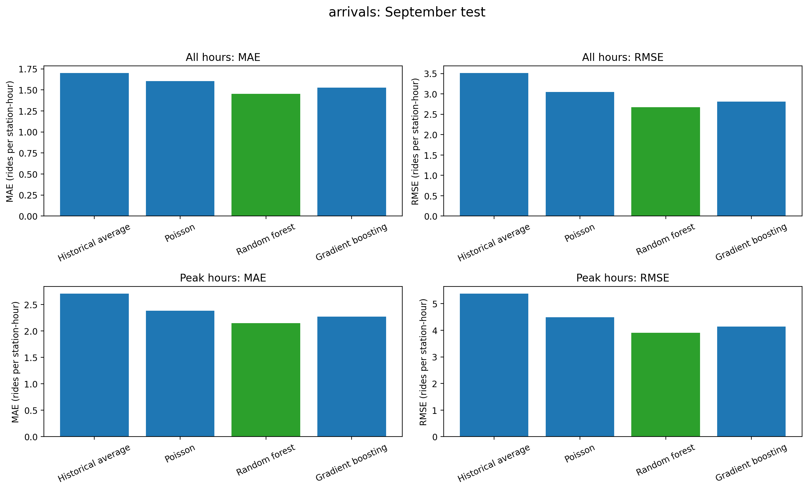
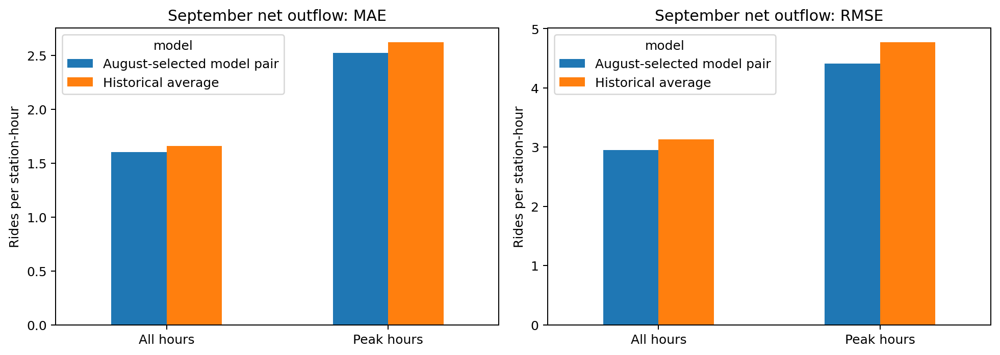
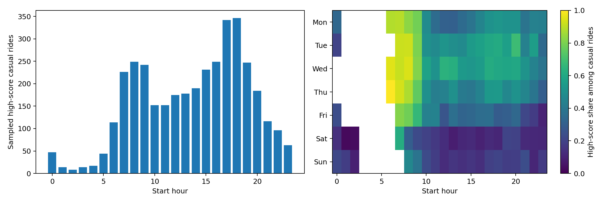
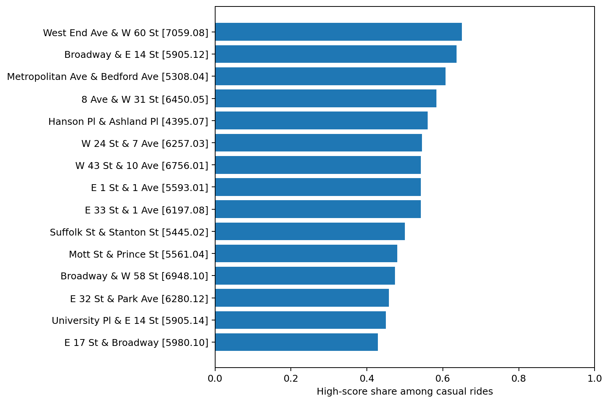

# Modeling results

Both tasks use April–July 2025 for training, August for validation, and September for testing. After model selection, models are refitted on April–August and evaluated on September. Calendar features use New York local time. The notebooks contain the code, saved outputs, and figures.

## 1. Station-hour demand forecasting

[Demand notebook](../notebooks/station_hour_demand_modeling.ipynb)

Predict departures and arrivals separately for each eligible station-hour, including zero-flow hours. The run covers 2,342 stations, with 6,396,447 training rows, 1,601,673 validation rows, and 1,548,059 test rows. Features include station identity, calendar variables, counts from 1, 24, and 168 hours earlier, and historical 24-hour averages. This is rolling one-hour-ahead forecasting: prior observed September flows may be used to forecast later September hours. Weather and holiday features are not included in the current models.

Compare a historical station-and-hour average baseline with Poisson regression, random forest, and gradient boosting. Preprocessing is fitted on training data, and parameters and models are selected by August MAE. Random forest was selected for both outcomes.

| Model | Departure MAE | Departure RMSE | Arrival MAE | Arrival RMSE |
| --- | ---: | ---: | ---: | ---: |
| Historical average | 1.6803 | 3.4591 | 1.7008 | 3.5132 |
| Poisson regression | 1.5830 | 2.9906 | 1.6038 | 3.0474 |
| Random forest | 1.4285 | 2.6355 | 1.4538 | 2.6764 |
| Gradient boosting | 1.5081 | 2.7670 | 1.5286 | 2.8081 |

Errors are in rides per station-hour; lower is better. Random forest reduced overall departure and arrival MAE by 14.99% and 14.53% relative to the baseline. During weekday peak hours (07, 08, 09, 16, 17, and 18), reductions were 20.88% and 20.64%. Peak-hour absolute errors remained higher than overall errors.

Random forest (green) has the lowest MAE and RMSE for both outcomes, overall and during peak hours.

## 2. Net outflow and inventory pressure

Net outflow is departures minus arrivals. Subtract the paired flow predictions without retraining or selecting another model on the test set. Positive values indicate net bicycle depletion; negative values indicate net accumulation.

| Period | Baseline MAE | Selected pair MAE | Selected pair RMSE | MAE reduction |
| --- | ---: | ---: | ---: | ---: |
| All hours | 1.6597 | 1.6046 | 2.9516 | 3.32% |
| Peak hours | 2.6211 | 2.5211 | 4.4125 | 3.81% |

Net-outflow gains were smaller than gains for the individual flows. Departure and arrival prediction errors can cancel or reinforce when subtracted. These forecasts describe observed trip flows, not actual station inventory; empty or full stations cannot be determined without inventory and capacity information.

The selected pair improves net-outflow errors relative to the historical baseline, but the improvement is smaller than for departures and arrivals separately.

## 3. Rider-type classification

[Rider-type notebook](../notebooks/rider_type_classification.ipynb)

Classify completed rides as member or casual using timing, bicycle type, station IDs and coordinates, log duration, and log straight-line endpoint distance. Use deterministic ride-ID samples of 150,000 training rides, 50,000 validation rides, and 50,000 test rides. Include rides with known positive durations of at most 24 hours under the cleaning eligibility rule. Fit imputation and category encoding within the training pipelines.

Logistic regression is the baseline, compared with random forest and standard gradient boosting. Select the model using August ROC-AUC. Gradient boosting was selected with validation ROC-AUC 0.735.

| Model | Member precision | Member recall | Member F1 | Test ROC-AUC |
| --- | ---: | ---: | ---: | ---: |
| Logistic regression | 0.825 | 0.982 | 0.896 | 0.693 |
| Random forest | 0.813 | 1.000 | 0.897 | 0.683 |
| Gradient boosting | 0.827 | 0.982 | 0.898 | 0.708 |

Decision metrics use a 0.5 member-score threshold. Members account for 81.17% of test rides. Although gradient boosting improves ROC-AUC over the baseline, casual recall is only about 12%, so the model still strongly favors the majority member class.

## 4. Member-like casual ride patterns

Using the selected gradient boosting model, 3,696 of 9,415 casual test rides (39.26%) received a member score of at least 0.8. The notebook summarizes high-score counts and within-group shares by start hour, weekday/hour, and start station. Station rankings require at least 20 sampled casual rides, so small-group comparisons remain exploratory.

This is retrospective analysis because duration and endpoints are known only after a ride ends. Scores indicate similarity to observed member rides, not membership purchase probability. Results apply to the selected periods and populations; they do not establish year-round performance or individual rider behavior.

The left panel shows sampled high-score counts by start hour; the right panel shows their share among casual rides by weekday and hour. Blank cells have fewer than 20 sampled casual rides. Weekday mornings show higher shares, while the largest counts occur in the late afternoon and early evening.

These are the top 15 stations by high-score share among stations with at least 20 sampled casual rides. West End Ave & W 60 St leads with 13 of 20 rides (65%). Small denominators make the ranking sensitive to sampling; it is exploratory rather than a confirmed promotion priority.
